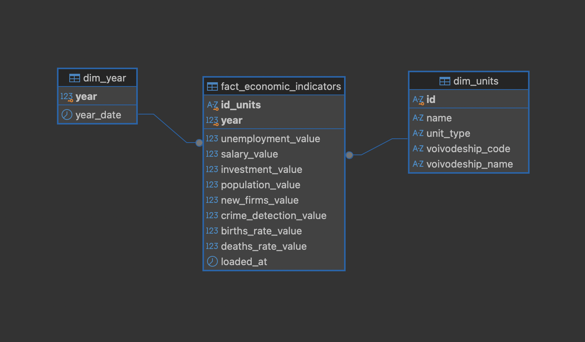

# Project 1: Macroeconomic Analysis — Full ETL Pipeline (GUS BDL API)

## Overview
This project implements a complete, production-grade **ETL/ELT pipeline** for regional macroeconomic data, sourced from the **Statistics Poland (GUS)** public REST API. The pipeline extracts 8 key performance indicators for **380+ Polish counties (powiats)** across 7 years (2018–2024), transforms deeply nested JSON responses, and loads the results into a **star schema** in a **PostgreSQL** database — ready for advanced SQL analysis and **Power BI** dashboarding.

> **Key Highlight:** This project demonstrates **two independent data loading strategies** (ETL and ELT), showcasing versatility in both Python-centric and SQL-centric data engineering approaches.

## Business Objectives
- Automate the extraction of 8 macroeconomic indicators using a scalable, loop-driven architecture.
- Handle API rate-limiting (HTTP 429), pagination, and robust error handling.
- Process nested JSON API responses into flat, analytical structures using **Pandas** and **Apache Parquet**.
- Model the data as a **star schema** (fact + dimensions) with incremental, idempotent loading.
- Deliver clean, compressed data to **PostgreSQL** for SQL analysis and **Power BI** for executive dashboarding.

---

## Data Architecture: Medallion Pattern (Bronze → Silver → Gold)

```
   ┌─────────────┐      ┌──────────────────┐      ┌───────────────────┐
   │  GUS REST   │      │   Pandas + JSON   │      │    PostgreSQL     │
   │    API      │ ───► │   Normalize +     │ ───► │   Staging  →      │
   │  (Source)   │      │   Pivot Table     │      │   Star Schema     │
   └─────────────┘      └──────────────────┘      └───────────────────┘
     Bronze Layer          Silver Layer              Gold Layer
   01_extract_api.py    02_transform_pandas.py    03a / 03b scripts
      Raw JSON          Apache Parquet (backup)    fact + dimensions
```

---

## Two Data Loading Strategies (ETL vs ELT)

This project intentionally implements **two different approaches** to the Gold Layer. Both fill the same staging table and run the same SQL, so they produce an identical star schema (verified row by row):

### Approach A: ELT — Raw JSON → PostgreSQL (SQL-Centric)
**Script:** `03a_load_sql_raw_json.py`

In this approach, raw JSON files are loaded directly into PostgreSQL, and the database engine handles all transformation logic using advanced SQL functions:
- **`json_to_recordset()`** — PostgreSQL native JSON parsing
- **`CROSS JOIN`** — Flattening nested arrays inside the database
- **`ON CONFLICT DO UPDATE` (UPSERT)** — Idempotent, incremental loading
- **Star Schema**: `dim_units`, `dim_year` and `fact_economic_indicators` built directly by the load script

> *Best suited for:* Teams with strong SQL/DBA expertise, real-time ingestion pipelines, and environments where Python is not available.

### Approach B: ETL — Parquet → PostgreSQL (Python-Centric)
**Script:** `03b_load_sql_parquet.py`

In this approach, all transformation is handled upstream in Python (Pandas), and the pre-processed, wide-format **Apache Parquet** file (which also serves as a backup of the extracted data) is loaded into PostgreSQL via `SQLAlchemy`:
- **`pd.json_normalize()`** — Recursive JSON flattening in Python
- **`pivot_table()`** — Reshaping long-to-wide format (Silver layer)
- **`to_parquet()` / `read_parquet()`** — Columnar storage with compression (PyArrow engine)
- **`melt()` + `to_sql()`** — Unpivot back to long format and bulk insert into the staging table, then the shared SQL builds the star schema

> *Best suited for:* Data Science teams, rapid prototyping, and environments where Python/Pandas is the primary tool.

---

## Data Model: Star Schema



**Grain:** one row = one county × one year (380 × 7 = **2,660 rows**). Foreign keys guarantee that every fact row points to an existing county and year.

### Tables

| Object | Type | Rows | Purpose |
|---|---|---|---|
| `fact_economic_indicators` | Fact | 2,660 | All 8 indicators per county and year, plus `loaded_at` audit timestamp |
| `dim_units` | Dimension | 380 | County name, unit type (314 land counties, 66 city counties), voivodeship (derived from characters 3–4 of the unit code) |
| `dim_year` | Dimension | 7 | Year 2018–2024 and `year_date` (31 Dec) for time intelligence in BI tools |
| `stg_gus_values` | Staging | 21,280 | Long format (indicator × county × year), cleared on every load. Not for analysis |
| `gus_indicators` | View | 2,660 | Flat fact + county view with Polish column names, used by `sql_analysis/04_business_queries.sql` |

### Measures

| Column | Indicator | Unit | Additive? |
|---|---|---|---|
| `unemployment_value` | Registered unemployed | persons | Yes |
| `population_value` | Total population | persons | Yes |
| `investment_value` | Capital investment in enterprises | thousand PLN | Yes |
| `salary_value` | Average gross monthly salary | PLN | No — use a population-weighted average |
| `new_firms_value` | New REGON entities | per 10k working-age pop. | No |
| `crime_detection_value` | Crime detection rate | % | No |
| `births_rate_value` | Live births | per 1,000 pop. | No — weight by population |
| `deaths_rate_value` | Deaths | per 1,000 pop. | No — weight by population |

The fact table is **wide** (one column per indicator). With a fixed set of indicators this keeps ratio calculations simple, e.g. unemployment as a share of population:

```sql
select
    u.voivodeship_name,
    f.year,
    round(sum(f.unemployment_value)::numeric / sum(f.population_value) * 100, 2) as unemployment_pct
from fact_economic_indicators f
join dim_units u on u.id = f.id_units
group by u.voivodeship_name, f.year
order by f.year, unemployment_pct desc;
```

### Loading logic

Both loaders run in a **single transaction**: either the whole load succeeds or the database stays unchanged.

1. `sql/01_create_star_schema.sql` — creates tables if they don't exist (`CREATE TABLE IF NOT EXISTS`) and clears the staging table. Existing data is never dropped.
2. Loader fills `stg_gus_values` — from raw JSON via `json_to_recordset()` (03a) or from Parquet via `melt()` (03b).
3. `sql/02_populate_star_schema.sql` — **incremental UPSERT** (`ON CONFLICT DO UPDATE`):
   - new counties and years are appended, existing rows are updated;
   - rows not present in the current load (e.g. older years) stay untouched;
   - `COALESCE` keeps the previous value if an indicator is missing in the current load.
4. `sql/03_quality_checks.sql` — expected result: 380 counties, 7 years, 2,660 fact rows, 0 NULLs, 16 voivodeships.

**Adding a new year:** add it to `LATA` in `scripts/config.py`, then run steps 1 → 2 → 3. Historical years remain in the database.

---

## Project Structure

```
01_Macroeconomic_Analysis_GUS/
├── README.md                          # Project documentation
├── Zadanie_Dodatkowe.md               # Business requirements & analyst brief
│
├── scripts/
│   ├── 01_extract_api.py              # Bronze: API extraction, pagination, rate-limit handling
│   ├── 02_transform_pandas.py         # Silver: JSON flattening, pivot, Parquet export
│   ├── 03a_load_sql_raw_json.py       # Gold (ELT): JSON → staging via SQL → star schema
│   ├── 03b_load_sql_parquet.py        # Gold (ETL): Parquet → staging via Pandas → star schema
│   ├── config.py                      # Shared paths, indicator list, DB connection (.env)
│   └── sql/
│       ├── 01_create_star_schema.sql  # DDL: staging + dim_units, dim_year, fact (PK/FK)
│       ├── 02_populate_star_schema.sql# Staging → dimensions + facts, flat view gus_indicators
│       └── 03_quality_checks.sql      # Row counts, NULL checks, voivodeship coverage
│
├── sql_analysis/
│   └── 04_business_queries.sql        # Business Queries: Window Functions (LAG), CTEs, Aggregations
│
├── images/
│   └── star_schema.png                # ER diagram of the star schema (DBeaver)
│
└── dane/
    ├── dane_*.json                    # Raw API responses (Bronze layer)
    └── merged_data.parquet            # Transformed wide-format dataset (Silver layer)
```

## Indicators Tracked

| Indicator ID | Name (PL) | Name (EN) | Unit | GUS Subject |
|---|---|---|---|---|
| 459121 | Bezrobocie | Unemployment | persons | P2425 |
| 64428 | Wynagrodzenia | Average Salary | PLN | P3045 |
| 155064 | Nakłady inwestycyjne | Capital Investments | thousand PLN | P2862 |
| 58565 | Wykrywalność przestępstw | Crime Detection Rate | % | P2290 |
| 395374 | Nowe podmioty REGON | Newly Registered Businesses | per 10k working-age pop. | P2419 |
| 72305 | Ludność ogółem | Total Population | persons | P2137 |
| 450540 | Urodzenia | Live Births Rate | per 1,000 pop. | — |
| 450541 | Zgony | Deaths Rate | per 1,000 pop. | — |

## Technology Stack

| Layer | Technology | Purpose |
|---|---|---|
| Extraction | Python `requests` | REST API communication, pagination, HTTP 429 handling |
| Transformation | `pandas`, `json`, `glob` | JSON flattening, pivot tables, data merging |
| Storage | Apache Parquet (`pyarrow`) | Columnar compression, type preservation |
| Database | PostgreSQL 16 | Relational storage, analytical SQL queries |
| ORM / Connector | SQLAlchemy + psycopg2 | Python ↔ PostgreSQL bridge |
| Visualization | Power BI *(planned)* | Executive dashboards, KPI reporting |

## How to Run
```bash
# Run from any directory — paths are resolved in scripts/config.py

# Step 1: Extract raw data from GUS API (Bronze Layer)
python scripts/01_extract_api.py

# Step 2: Transform & merge into Parquet (Silver Layer)
python scripts/02_transform_pandas.py

# Step 3: Load into PostgreSQL and build the star schema (Gold Layer) — choose one:
python scripts/03a_load_sql_raw_json.py   # ELT approach (SQL-centric)
python scripts/03b_load_sql_parquet.py    # ETL approach (Python-centric)
```

Database credentials are read from `.env` in the project root (`DB_USER`, `DB_PASSWORD`, `DB_HOST`, `DB_PORT`, `DB_NAME`). See [Data Model: Star Schema](#data-model-star-schema) for what step 3 builds.

## Current Status
- [x] REST API Integration with pagination & rate-limit handling
- [x] Pandas data transformation & Apache Parquet export
- [x] PostgreSQL loading (two independent strategies: ETL & ELT)
- [x] Star schema with incremental UPSERT loading and quality checks
- [x] Advanced SQL Analysis (Window Functions, CTEs, Ranking)
- [ ] Power BI Executive Dashboard

---

## Legal Disclaimer & Data Sources
**Data Source Attribution:**
All public statistical data utilized in this project is sourced from the **Statistics Poland (Główny Urząd Statystyczny - GUS)** via their official [Local Data Bank (BDL) API](https://bdl.stat.gov.pl/api/v1/).

**License:**
The data is provided under the **Creative Commons Attribution 4.0 International (CC BY 4.0)** license. The original creator of the statistical data is Statistics Poland (GUS). This repository and its creator are not affiliated with, nor endorsed by, Statistics Poland.
