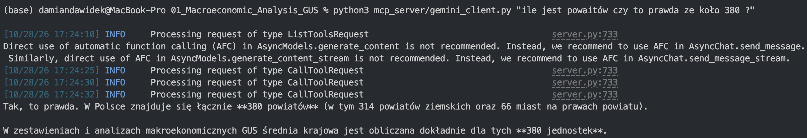

# MCP server for the GUS star schema

A small **Model Context Protocol (MCP)** server that lets an AI model (Gemini, Claude, …) answer questions about the GUS county data. The model does **not** write SQL. It can only call a few ready-made, read-only tools that query the PostgreSQL star schema built by the ETL pipeline.

```
  "Top 5 counties by unemployment in 2023?"
                    │
                    ▼
   ┌─────────────────────────┐   calls tools    ┌──────────────────┐   SQL (SELECT)   ┌──────────────┐
   │  AI model (MCP client)  │ ───────────────► │   server.py      │ ───────────────► │  PostgreSQL  │
   │  Gemini / Claude / ...  │ ◄─────────────── │   (MCP server)   │ ◄─────────────── │  star schema │
   └─────────────────────────┘   JSON results   └──────────────────┘      rows        └──────────────┘
                    │
                    ▼
        Answer in natural language
```

## Demo

A question in Polish (*"How many counties are there, is it true that about 380?"*). Gemini called the tools 3 times (`CallToolRequest`) and answered from the database: **380 counties = 314 rural counties (powiaty ziemskie) + 66 cities with county rights**. The numbers match `dim_units`.



## Tools

| Tool | What it does |
|---|---|
| `list_indicators` | Indicator names to use in other tools, their units and years |
| `list_voivodeships` | The 16 voivodeship names |
| `search_county` | Find counties by part of the name (names are not unique, so it returns `id` + voivodeship) |
| `get_indicator` | Value of an indicator for one county, or the full 2018–2024 time series |
| `compare_to_national` | County vs. national average: difference and ratio |
| `top_counties` | Ranking by indicator and year, optional voivodeship filter |
| `voivodeship_summary` | Average of an indicator per voivodeship |

Indicators: `unemployment`, `salary`, `investment`, `population`, `new_firms`, `crime_detection`, `births`, `deaths`.

## Setup

**Requirements:** the PostgreSQL database must be running and already loaded (see the [main README](../README.md#how-to-run)).

```bash
pip install -r mcp_server/requirements.txt
```

The project's `.env` file (git-ignored, never commit it) needs:

```
DB_USER=...
DB_PASSWORD=...
DB_HOST=localhost
DB_PORT=5432
DB_NAME=Projekt_1

GEMINI_API_KEY=...            # only for gemini_client.py
GEMINI_MODEL=gemini-3.5-flash # optional, this is the default
```

## How to use it

### 1. Command line with Gemini (`gemini_client.py`)

The fastest way to test it. The script starts `server.py` in the background, gives the MCP tools to Gemini, and prints the answer.

```bash
python3 mcp_server/gemini_client.py "Top 5 counties by unemployment in 2023"
python3 mcp_server/gemini_client.py "Jak wynagrodzenie w powiecie lubelskim wypada na tle średniej krajowej w 2023?"
```

Example output (the model called `list_indicators` and `top_counties` by itself):

```
1. Powiat m. Łódź (łódzkie) – 5 193 persons
2. Powiat m. st. Warszawa (mazowieckie) – 3 717
3. Powiat m. Kraków (małopolskie) – 2 641
4. Powiat m. Białystok (podlaskie) – 2 346
5. Powiat m. Włocławek (kujawsko-pomorskie) – 2 033
```

The `INFO Processing request of type CallToolRequest` lines in the terminal show each time the model calls a tool.

### 2. Claude Desktop

Open *Settings → Developer → Edit Config* (`~/Library/Application Support/Claude/claude_desktop_config.json` on macOS) and add the server. Use **absolute paths** and the Python interpreter that has the requirements installed (`which python3`):

```json
{
  "mcpServers": {
    "gus-counties": {
      "command": "/full/path/to/python3",
      "args": ["/full/path/to/01_Macroeconomic_Analysis_GUS/mcp_server/server.py"]
    }
  }
}
```

Restart Claude Desktop. The tools then show up in the chat and you can ask questions directly.

### 3. Claude Code

```bash
claude mcp add gus-counties -- python3 /full/path/to/mcp_server/server.py
```

### 4. MCP Inspector (debugging, no AI model)

A browser UI where you call each tool by hand and see the raw JSON it returns. It needs Node.js:

```bash
npx @modelcontextprotocol/inspector python3 mcp_server/server.py
```

## Example questions

- *Which 10 counties had the highest average salary in 2024?*
- *Show the unemployment time series for powiat grodziski in mazowieckie.*
- *Which voivodeship had the highest crime detection rate in 2022?*
- *Compare births in powiat m. Kraków with the national average in 2020.*

## Design choices (security)

- **No free-form SQL.** Every tool runs a fixed query with parameters (`:rok`, `:woj`, …). Column names come only from the `WSKAZNIKI` whitelist in `server.py`, so text from the user or the model never ends up in the SQL itself.
- Inputs are validated: indicator name, year 2018–2024, and `n` capped at 50 rows.
- You can use a **read-only database role**:
  ```sql
  CREATE ROLE mcp_reader LOGIN PASSWORD '...';
  GRANT CONNECT ON DATABASE "Projekt_1" TO mcp_reader;
  GRANT USAGE ON SCHEMA public TO mcp_reader;
  GRANT SELECT ON dim_units, dim_year, fact_economic_indicators TO mcp_reader;
  ```
  Put it in `.env` as `MCP_DB_USER` / `MCP_DB_PASSWORD`. These are used instead of `DB_USER` / `DB_PASSWORD` when set.
- API keys live only in the git-ignored `.env`.

## Limitations

- The model only knows what the tools return: 8 indicators, counties, 2018–2024. It cannot answer from outside the database (for example 2025 data or gminy).
- The server needs a live database connection. If PostgreSQL is not running, the tool calls fail.
